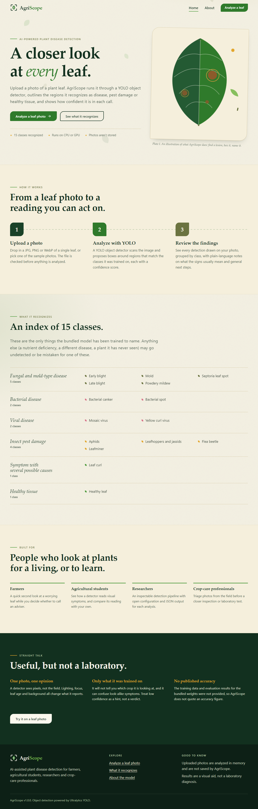
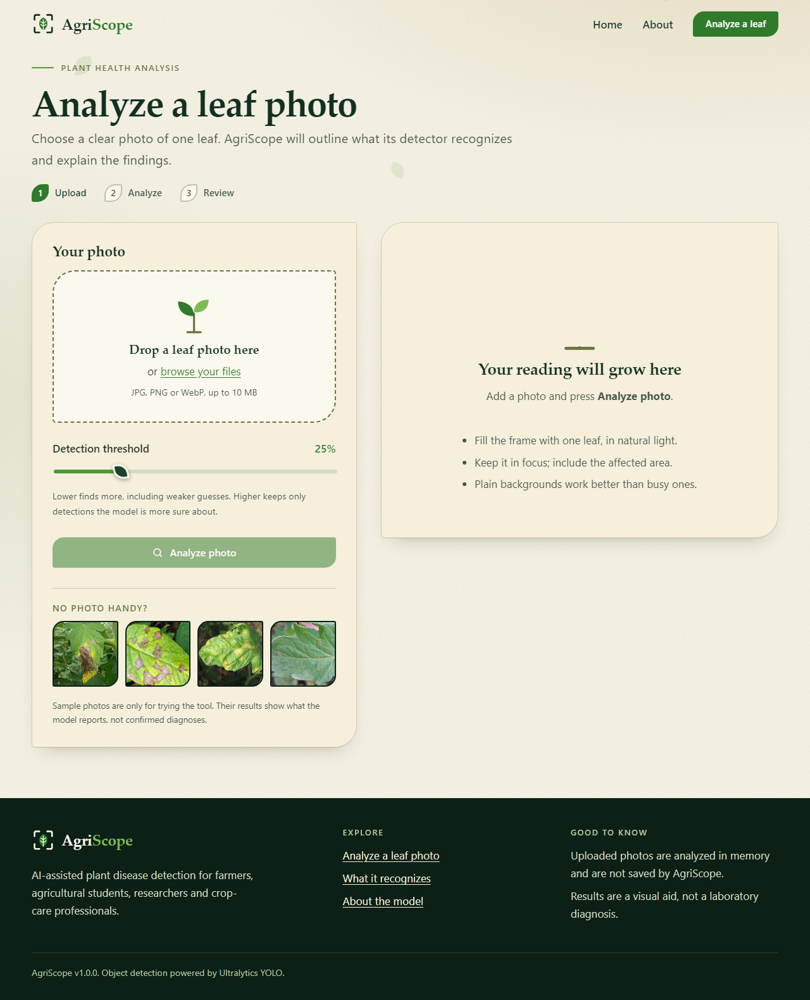
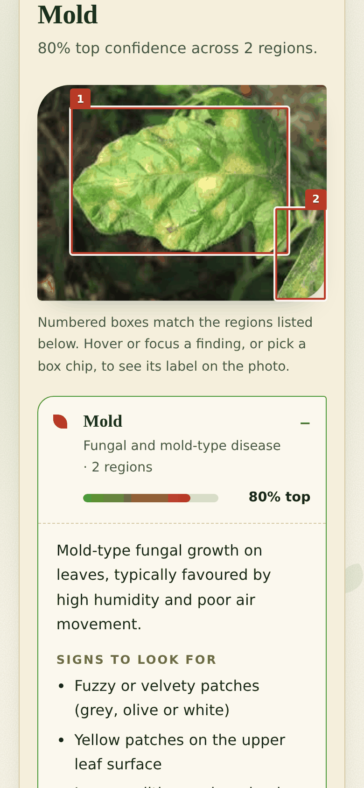

 <div align="center">

<div align="center">
  

  <h3>Detect. Analyze. Understand. Protect.</h3>
</div>

**Detect. Analyze. Understand. Protect.**

An AI-powered plant disease detection platform that uses YOLO object detection to identify crop diseases, pest damage, and healthy leaf tissue through image analysis.

[](https://www.python.org/)
[](https://flask.palletsprojects.com/)
[](https://docs.ultralytics.com/)
[](https://developer.mozilla.org/en-US/docs/Web/JavaScript)
[](https://developer.mozilla.org/en-US/docs/Web/HTML)
[](https://developer.mozilla.org/en-US/docs/Web/CSS)

[Features](#features) • [How It Works](#how-it-works) • [Model Details](#model-details) • [API](#api) • [Security](#security--privacy)

</div>

---

## Overview

Identifying crop diseases at an early stage can help prevent agricultural losses. However, expert assistance is not always immediately available.

**AgriScope** provides farmers, agricultural students, researchers, and crop-care professionals with a visual second opinion through AI-powered leaf image analysis.

Upload a plant leaf image and let the YOLO object detector identify visible disease symptoms, pest damage, or healthy tissue. Review detection boxes, confidence scores, grouped findings, and general reference guidance.

AgriScope is designed as a decision-support tool, not a replacement for laboratory diagnosis or professional agronomic advice.




## Features

- **AI-Powered Detection:** YOLO-based object detection for 15 plant disease, pest, and healthy-leaf classes.
- **Simple Image Upload:** Drag-and-drop, paste, file picker, and bundled sample images.
- **Visual Detection Results:** Bounding boxes highlight exactly where the model identifies findings.
- **Confidence Scores:** Review individual detection confidence values.
- **Adjustable Threshold:** Customize the detection confidence threshold.
- **Grouped Findings:** Organize detections by class with corresponding reference notes.
- **Reference Guidance:** General symptoms and suggested next steps for all 15 supported classes.
- **JSON Export:** Export individual detection results for further analysis.
- **Robust Validation:** Image type, file size, dimensions, pixel count, and corrupt-file validation.
- **Transparent Model Output:** All displayed detections originate from actual model predictions.
- **Responsive Interface:** Designed for desktop, tablet, and mobile screens.
- **JSON API:** Programmatic access through detection and health endpoints.

## Screenshots

<div align="center">

### Landing Page


### Image Analysis


### Detection Results


### Mobile Experience


</div>

## How It Works

AgriScope follows a straightforward image-analysis pipeline:

1. **Upload:** The user submits a JPG, PNG, or WebP plant image.
2. **Validation:** The server validates the file, checks image dimensions, corrects EXIF orientation, and converts it to RGB.
3. **Inference:** The shared Ultralytics YOLO model processes the image using the selected confidence threshold.
4. **Detection:** The model returns detected classes, confidence scores, and bounding-box coordinates.
5. **Visualization:** Detection boxes are drawn over the original image.
6. **Guidance:** Findings are grouped and displayed alongside relevant reference notes.

## Model Details

| Attribute | Details |
|---|---|
| Model | YOLOv8s |
| Framework | Ultralytics |
| Ultralytics Version | 8.2.103 (training metadata) |
| Task | Object Detection |
| Number of Classes | 15 |
| Input Size | 800 |
| Model Weights | `models/best.pt` |

**Important:** The bundled model is YOLOv8s, not YOLO11. Its training dataset and evaluation metrics are unavailable, so no accuracy claims are made.

### Supported Detection Classes

| ID | Detection Class |
|---|---|
| 0 | Aphids |
| 1 | Early Blight |
| 2 | Healthy Leaf |
| 3 | Leaf Curl |
| 4 | Leafhoppers and Jassids |
| 5 | Mold |
| 6 | Mosaic Virus |
| 7 | Septoria Leaf Spot |
| 8 | Bacterial Canker |
| 9 | Bacterial Spot |
| 10 | Flea Beetle |
| 11 | Late Blight |
| 12 | Leafminer |
| 13 | Powdery Mildew |
| 14 | Yellow Curl Virus |

Class names are normalized for display where necessary. The underlying model class IDs and weights remain unchanged.

## API

AgriScope provides JSON endpoints for integration and programmatic access.

| Endpoint | Method | Description |
|---|---|---|
| `/api/detect` | POST | Analyze an uploaded plant image |
| `/api/health` | GET | Check model availability |

### Detection API

`POST /api/detect`

**Request parameters:**
- `file`: Plant image (JPG, PNG, or WebP).
- `confidence`: Optional detection threshold (0.05–0.95).

**Response includes:**
- Image dimensions
- Selected confidence threshold
- Inference time
- Detection class and ID
- Confidence score
- Bounding-box coordinates
- Grouped findings and reference guidance

The API also provides structured error responses for invalid uploads, unsupported formats, oversized images, inference failures, and unavailable models.

## Security & Privacy

- Images are processed in memory and discarded after analysis.
- No uploaded images are permanently stored by the application.
- File validation uses actual file content rather than trusting filenames or declared MIME types.
- Upload size, image pixel count, and detection limits are enforced.
- API errors do not expose internal stack traces or server file paths.
- Ultralytics automatic runtime installation is disabled.
- Security headers include Content Security Policy, MIME sniffing protection, and frame denial.
- No user accounts, analytics, third-party scripts, external fonts, or external API keys are required.

## Limitations

- Detection is restricted to the 15 classes supported by the bundled model.
- Crop species identification is not supported.
- Image quality, lighting, blur, and complex backgrounds can affect detection.
- Confidence scores represent model confidence, not the probability of a correct diagnosis.
- The bundled model's training dataset and independently evaluated performance metrics are unavailable.
- Reference guidance is informational and does not replace professional agricultural advice.

## Project Structure

```text
AgriScope/
│
├── app.py
├── agriscope/
│   ├── __init__.py
│   ├── config.py
│   ├── detector.py
│   ├── imaging.py
│   ├── knowledge.py
│   └── routes.py
│
├── models/
│   └── best.pt
│
├── templates/
├── static/
│   ├── css/
│   ├── js/
│   ├── img/
│   └── samples/
│
├── tests/
├── docs/
│   └── screenshots/
│
├── requirements.txt
└── requirements-dev.txt
```

## Testing

AgriScope includes a pytest suite covering application pages, API behavior, validation, and model integration.

- Application and API tests use a fake detector, allowing them to run without PyTorch.
- Model integration tests use the actual bundled weights.
- Integration tests are automatically skipped when the required model or Ultralytics dependency is unavailable.

---

<div align="center">

### Bringing AI Closer to Smarter Agriculture

**AgriScope — Detect Early. Understand Better. Grow Smarter.**


</div>
