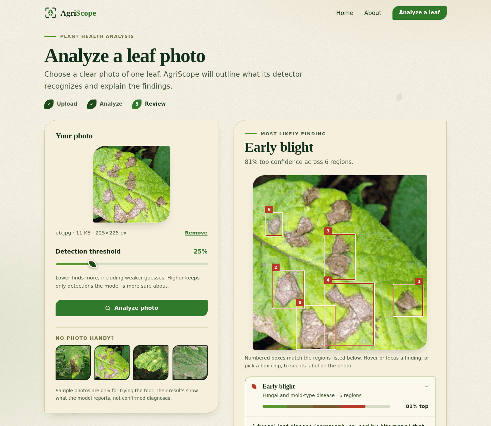

# AgriScope

**AI-powered plant disease detection.** Upload a photo of a plant leaf, analyze it with a YOLO object detector,
and review exactly where the model sees disease, pest damage or healthy tissue, along with how confident it is.


## What it is for

Spotting crop problems early matters, but expert help isn't always at hand. AgriScope gives **farmers, agricultural
students, researchers and crop-care professionals** a fast, visual second opinion on a leaf photo and plain-language
notes on what the detected signs usually mean. It is a decision aid, **not** a laboratory diagnosis.

## Features

* **Upload → Analyze → Review** workflow with drag-and-drop, paste, file picker and bundled sample photos.
* Client- and server-side validation (type, size, pixel count, corrupt files) with clear inline errors.
* **Real model output only:** every box, class and confidence on screen comes from the loaded weights.
* Detection boxes drawn on your photo, grouped findings, adjustable detection threshold, JSON export of each result.
* Static, clearly labelled reference notes (signs to look for, general next steps) for each of the 15 classes.
* Honest states: empty, analyzing (indeterminate, with elapsed time and cancel), no detections, errors, model unavailable.
* Responsive layout (tested at desktop, tablet and phone widths), keyboard-operable, `prefers-reduced-motion` respected.
* JSON API (`/api/detect`, `/api/health`) for scripting.

| | |
|---|---|
|  |  |


## How detection works

1. The browser sends the image to `POST /api/detect`.
2. The server checks the file (magic bytes, size, dimensions), corrects EXIF rotation, and converts it to RGB, all in memory.
3. A single, shared Ultralytics model (loaded once at startup) predicts boxes at the confidence threshold you chose.
4. The server returns every detection (class, confidence, box in pixel coordinates), grouped into findings.
5. The page draws the boxes over your photo and shows the matching reference notes.

### About the bundled model

| | |
|---|---|
| File | `models/best.pt` |
| Task | Object detection, 15 classes, input size 800 |
| Architecture | **YOLOv8s** (the file's training metadata records `yolov8s.pt` as the base and Ultralytics 8.2.103). It is **not** a YOLO11 model. |
| Training data / metrics | Not provided with the project, so **no accuracy figures are quoted** |

Any Ultralytics *detection* weights can be used via `AGRISCOPE_MODEL_PATH`. Stock `yolo11n.pt` was loaded and run
through the same code path as a compatibility check (it has COCO classes, not plant diseases). Classes AgriScope has
no reference notes for are shown under their raw names without guidance.

**Classes (id: name in the weights → label shown):**
0 `Aphids`, 1 `Early Blight`, 2 `Healthy Leaf-` (Healthy leaf), 3 `Leaf Curl`, 4 `Leafhoppers and Jassids`, 5 `Molds` (Mold),
6 `Mosaic Virus`, 7 `Septoria` (Septoria leaf spot), 8 `bactarial canker` (Bacterial canker), 9 `bacterial spot`,
10 `flea beetle`, 11 `late_blight` (Late blight), 12 `leafminer`, 13 `powedry_mildew` (Powdery mildew), 14 `yellow curl virus`.
Typos in the weights' class names are corrected for display only; class IDs and the model are unchanged.

## Quick start

Requires Python 3.10+.

```bash
python -m venv .venv
# Windows: .venv\Scripts\activate      macOS/Linux: source .venv/bin/activate

# Optional but recommended on CPU-only machines (much smaller than the default CUDA build):
pip install torch torchvision --index-url https://download.pytorch.org/whl/cpu

pip install -r requirements.txt
python app.py            # http://127.0.0.1:5000
```

Production-style serving (cross-platform):

```bash
waitress-serve --listen=0.0.0.0:8000 --call agriscope:create_app
```

The app starts even if the model can't load. In that case the Analyze page shows a clear banner and `/api/detect`
returns `503 model_unavailable` instead of fabricating a result.

### Configuration

Environment variables (or a `.env` file; see [`.env.example`](.env.example)):

| Variable | Default | Meaning |
|---|---|---|
| `AGRISCOPE_MODEL_PATH` | `models/best.pt` | Weights file (relative to project root or absolute) |
| `AGRISCOPE_CONF` | `0.25` | Default confidence threshold (0.05–0.95) |
| `AGRISCOPE_MAX_UPLOAD_MB` | `10` | Upload size limit |
| `AGRISCOPE_MAX_PIXELS` | `40000000` | Reject images with more pixels than this |
| `AGRISCOPE_MAX_DET` | `100` | Maximum detections per image |
| `AGRISCOPE_DEVICE` | `auto` | `auto`, `cpu`, or a GPU index such as `0` |
| `AGRISCOPE_IMGSZ` | from weights | Override inference image size |
| `AGRISCOPE_PRELOAD_MODEL` | `true` | Load the model at startup |
| `AGRISCOPE_HOST` / `AGRISCOPE_PORT` | `127.0.0.1` / `5000` | Dev server bind (`python app.py`) |
| `AGRISCOPE_DEBUG` | off | Flask debug mode. Development only. |

## API

`POST /api/detect`: multipart form with `file` (JPG/PNG/WebP) and optional `confidence` (0.05–0.95).

```jsonc
{
  "ok": true,
  "image": {"width": 195, "height": 259},
  "threshold": 0.25,
  "inference_ms": 1760,
  "detections": [
    {"id": 0, "class_id": 11, "raw_label": "late_blight", "label": "Late blight",
     "group": "Fungal and mold-type disease", "healthy": false, "confidence": 0.8275,
     "box": {"x1": 41.0, "y1": 30.5, "x2": 150.2, "y2": 238.0}}   // pixels, in the EXIF-corrected image
  ],
  "findings": [ /* detections grouped by class, with reference notes under "guidance" */ ]
}
```

Errors are always `{"ok": false, "error": {"code": "...", "message": "..."}}` with these statuses:
`400` `no_file`, `empty_file`, `invalid_confidence` · `413` `file_too_large` · `415` `unsupported_type` ·
`422` `corrupt_image`, `image_too_small`, `image_too_large` · `503` `model_unavailable` · `500` `inference_failed`, `internal_error`.
`GET /api/health` reports whether the model is loaded.

## Project structure

```
app.py                 entry point (dev server)
agriscope/
  __init__.py          app factory, error handlers, security headers
  config.py            environment-based configuration
  detector.py          model loading (once), thread-safe inference, result serialization
  imaging.py           upload validation and decoding (in memory)
  knowledge.py         static reference notes per class
  routes.py            pages and JSON API
models/best.pt         trained weights (see above)
templates/             Jinja pages (landing, detect, about, error)
static/                css/, js/ (vanilla, no build step), img/, samples/
tests/                 pytest suite
docs/screenshots/      images used in this README
```

## Testing

```bash
pip install -r requirements-dev.txt
pytest
```

The API/page tests use a fake detector and run without PyTorch. `tests/test_model_integration.py` loads the real
weights and is skipped automatically if `ultralytics` or `models/best.pt` is missing.

## Security and privacy

* Uploads are read into memory, validated by content (not by filename or declared type), analyzed and discarded.
  Nothing is written to disk, so there are no temporary files or path-traversal surface.
* Size, pixel-count and detection limits; decompression-bomb and truncated-file handling.
* API errors never include stack traces or file paths (details go to server logs only).
* Ultralytics runtime auto-install is disabled; the server never `pip install`s anything.
* Strict Content-Security-Policy (no inline scripts), `nosniff`, frame denial, same-origin referrer policy.
* No accounts, cookies, analytics, third-party scripts or fonts, and no external API keys.
* If you host AgriScope behind a proxy/CDN, that layer may keep its own logs. Review its retention.

## Known limitations

* The model recognizes only its 15 classes and cannot identify the crop species.
* It is sensitive to image quality; busy backgrounds, glare, blur and multiple leaves reduce reliability.
* Confidence is the model's score, **not** the probability that a diagnosis is right.
* Informal checks on the bundled samples show the model is imperfect: several sample files (named for a different
  condition) were assigned other classes or no detection. This is anecdotal, **not** an evaluation.
* Training data and evaluation metrics for `best.pt` are unavailable, so no accuracy figures are published here.
* Reference notes are general; they contain no product names or doses, and don't replace local agronomic advice.
* There is no detection history (by design: the app stores nothing).
* First request after startup is slower while the runtime warms up; CPU inference takes a few seconds per image.

